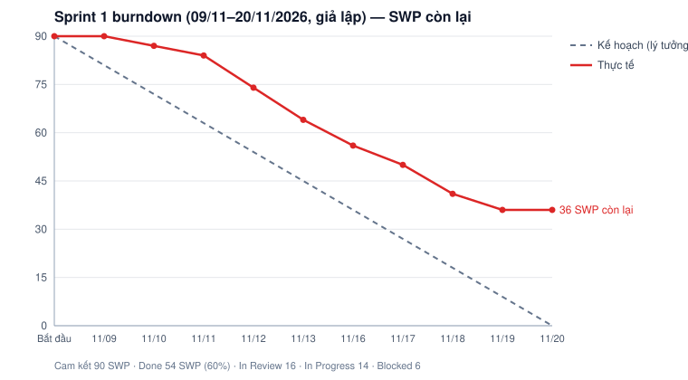

# Báo cáo tiến độ — Sprint 1 (giả lập)

| | |
|---|---|
| **Iteration trên Project** | `Sprint 1` (field Iteration của https://github.com/users/longtd-1487/projects/1) |
| **Khoảng thời gian giả lập** | 09/11/2026 (thứ Hai) – 20/11/2026 (thứ Sáu) · 10 ngày làm việc |
| **Gửi tới** | Ban quản lý dự án phía Công ty CP Chợ Thủy sản Vịnh Sakura |
| **Mục tiêu sprint** | Dựng nền tảng (Supabase/Vercel Tokyo, CI, dữ liệu nhóm A, RLS nền, audit, mã lỗi, khung giao diện) và gửi 5/7 gói câu hỏi làm rõ |
| **Lưu ý** | Số liệu trạng thái và giờ thực tế là **giả lập** (file [`backlog/sprint1-simulation.json`](backlog/sprint1-simulation.json)) để minh họa cách báo cáo. Trạng thái trên Project khớp với bảng dưới |

## 1. Trạng thái

| Trạng thái | Số issue | Tổng SWP | Ghi chú |
|---|---:|---:|---|
| Done | 10 | 54 | Hạ tầng Tokyo + CI (#67, #68); dữ liệu nhóm A, RLS nền, audit, mã lỗi, seed (#70–#73, #79); module PDF (#77); 2 gói câu hỏi đã có trả lời (#17, #18). Giờ thực tế 169 / ước lượng 162 |
| In Review | 2 | 16 | Nâng Next.js 15 / React 19 (#69): lỗi hydration ở 3 trang LAB-2, PR đang review. Hook mạng yếu (#76) |
| In Progress | 2 | 14 | Layout + menu theo vai trò (#75): bắt đầu muộn vì chờ #69. Gói câu hỏi nghiệp vụ sàn (#19): họp với ban quản lý dời sang 24/11 |
| Blocked | 2 | 6 | Thuế & làm tròn trên 適格請求書 (#15), quy tắc 完納奨励金 (#16): chờ kế toán thuế của khách trả lời |
| Todo (chưa bắt đầu) | 0 | 0 | |
| **Tổng cam kết** | **16** | **90** | **Hoàn thành 54 SWP (60%).** 6 issue chưa xong (36 SWP) chuyển sang Sprint 2 |

Giờ: ước lượng cho sprint 270 giờ (90 SWP × 3); thực tế đã dùng 252 giờ, trong đó 169 giờ cho task Done và 83 giờ cho task dở dang.

## 2. Burndown

| Cuối ngày | 09/11 | 10/11 | 11/11 | 12/11 | 13/11 | 16/11 | 17/11 | 18/11 | 19/11 | 20/11 |
|---|---|---|---|---|---|---|---|---|---|---|
| Kế hoạch (SWP còn lại) | 81 | 72 | 63 | 54 | 45 | 36 | 27 | 18 | 9 | 0 |
| Thực tế (SWP còn lại) | 90 | 87 | 84 | 74 | 64 | 56 | 50 | 41 | 36 | 36 |
| Task xong trong ngày | — | #18 | #17 | #67 | #70 | #68, #79 | #71 | #72, #73 | #77 | — |

**Thực tế lệch kế hoạch ở đâu:**
- **3 ngày đầu gần như phẳng.** Task hạ tầng #67 (10 SWP) là gốc của mọi task khác và vượt 8 giờ: Supabase Tokyo phải tạo project mới rồi chuyển dữ liệu seed thay vì đổi region, Vercel phải đổi gói để dùng region hnd1. Các task BE phía sau (#70, #68) dồn sang ngày 5–6.
- **Từ ngày 4 đến ngày 9 đốt đúng nhịp kế hoạch** (khoảng 8–10 SWP/ngày) nhờ 2 BE làm song song nhóm A, RLS, audit và mã lỗi.
- **Ngày 10 không đốt thêm.** Phần còn lại là các task FE phụ thuộc #69 (nâng Next.js gặp lỗi hydration, còn review) và 2 câu hỏi về tiền đang chờ khách. Đây là rủi ro R-01 và R-03 bên dưới.

## 3. Đề xuất cho Sprint 2

- **Cam kết Sprint 2:** 66 SWP theo kế hoạch + 36 SWP chuyển từ Sprint 1 = 102 SWP, vượt năng lực thực tế vừa đo (54 SWP/sprint). Đề xuất **giữ cam kết khoảng 60 SWP**: ưu tiên phần chuyển sang và 業務規程 (#97), lùi 2 task Should sang Sprint 3.
- **Sau Sprint 2:** cập nhật lại lịch 14 sprint theo velocity thật trung bình của 2 sprint.

## 4. Rủi ro trễ

| # | Rủi ro | Issue | Ảnh hưởng tới mốc nào | Hành động | Ai làm, khi nào |
|---|---|---|---|---|---|
| R-01 | Khách chưa trả lời câu hỏi thuế và quy tắc 完納 → không chốt được công thức hóa đơn và thưởng | #15, #16 (Blocked) → #155, #165–#177 | E10 bắt đầu Sprint 8 (15/02/2027); `close_period` Sprint 11. Trễ trả lời quá 31/12 thì E10 trễ ít nhất 1 sprint | Gửi lại câu hỏi kèm phương án mặc định và ví dụ số; đề nghị họp 30 phút với kế toán thuế của chợ; quá hạn thì dùng mặc định và ghi rõ trong biên bản | PM · gửi 23/11, hạn trả lời 04/12/2026 |
| R-02 | Velocity thật 54 SWP/sprint (60% cam kết); BE là điểm nghẽn (1.410 / 2.481 giờ backlog là BE, 2 người BE gần kín 60 giờ mọi sprint) | Toàn backlog; nặng nhất E06, E09, E10 | Mốc hoàn thành dự kiến 21/05/2027 (Sprint 14) có thể trễ 2–3 sprint nếu velocity không lên | Sprint 2: giảm cam kết còn khoảng 60 SWP; đề xuất thêm 1 BE từ Sprint 3, hoặc chuyển RPC đơn giản (danh mục, cài đặt) sang FE-2; tính lại lịch sau Sprint 2 | PM + Tech lead · sprint review 20/11, quyết định nhân sự trước 27/11 |
| R-03 | Nâng Next.js 15 / React 19 gây lỗi hydration, chặn mọi task FE | #69 (In Review) → #75 và FE Sprint 2 | Các màn đăng nhập, tài khoản (E02) Sprint 2 | Timebox 2 ngày; quá hạn thì giữ Next 14.2.35, chỉ gỡ service role (phần bảo mật), dời nâng cấp sang Sprint 4 | FE-1 · đến 25/11 |
| R-04 | Lịch tự động xếp hàm kiểm quyền mua #122 / #123 ở Sprint 10, trong khi task 相対 khác bắt đầu Sprint 6 → giao diện làm trước khi có kiểm quyền thật, dễ phải làm lại | #122, #123, #124–#127 | Demo luồng 相対 (lõi) cho khách dự kiến Sprint 8 | Bổ sung phụ thuộc #124 → #122 trong backlog, kéo #122 / #123 lên Sprint 5 | Tech lead · planning Sprint 2 (23/11) |
| R-05 | Chi phí hạ tầng Tokyo cao hơn dự kiến (Vercel đổi gói, 2 project Supabase) | #67 | Không ảnh hưởng tiến độ; ảnh hưởng ngân sách vận hành | Gửi khách bảng chi phí gói và xin xác nhận trước khi mở production | PM · 27/11 |
| R-06 | Họp ban quản lý chợ về nghiệp vụ sàn dời sang 24/11; trả lời khác mặc định sẽ đổi spec màn tablet | #19 → E05, E07 | E05 bắt đầu Sprint 5 (04/01/2027) | Giữ cuộc họp 24/11; cập nhật spec trong tuần đó, trước khi E05 vào sprint | PM / BA · 24–27/11 |
